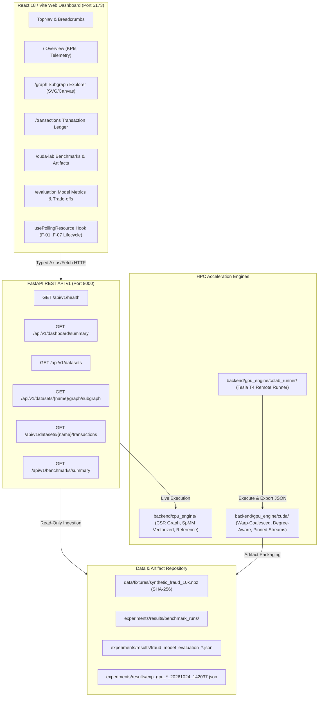

# FraudGraph Intelligence (FGI): System Architecture & Implementation Specification

**Document Status:** Authoritative Architectural & Technical Implementation Record  
**Target Course:** CSI4007 — GPU Programming Capstone  
**Institution:** Vellore Institute of Technology (VIT), Vellore Campus  
**Workspace:** `D:\FraudGraph Intelligence`  
**Git Baseline Commit:** `8afa28cf1172c006f0242f530267e8cc4466f9d6` (Branch `main`)  
**Version:** 1.0.0 (Phase 12 Release Candidate)  

---

## 1. System Overview & Architectural Topology

FraudGraph Intelligence (FGI) is a hybrid high-performance computing (HPC) and full-stack analytical platform engineered to accelerate graph-based financial fraud detection.

The platform couples:
1. **Low-Level CUDA Aggregation Kernels:** Optimized C++/CUDA kernels implementing parallel Compressed Sparse Row (CSR) neighbor aggregation across thread-per-node, warp-coalesced, pinned-stream double-buffered, and degree-aware hybrid paradigms.
2. **High-Performance CPU Reference & Vectorization Engine:** Standardized sequential Python reference loops and vectorized SciPy/NumPy Sparse Matrix-Dense Matrix Multiplication (SpMM) engines.
3. **Downstream Fraud Intelligence Pipeline:** Causal feature enrichment pipelines coupling graph neighborhood representations (Mean, Max, Sum, Multi-Operator) with class-imbalance-aware classifiers (Logistic Regression and Random Forest).
4. **FastAPI Backend Services (REST API v1):** Asynchronous Python backend delivering system telemetry, hardware detection, synthetic graph streaming, BFS subgraph extraction, and transaction pagination.
5. **Modern React/Vite Analytical Dashboard:** Dark-mode cybersecurity interface providing interactive topological subgraph exploration, transactional filtering, benchmark visualization, and live health monitoring.

---

## 2. Low-Level CUDA Acceleration Architecture

The CUDA compute engine is located under `backend/gpu_engine/cuda/` and comprises four distinct kernel implementation strategies:

### 2.1 File Organization & Build Infrastructure
- `include/fgi_cuda_common.cuh`: Common CUDA includes, error checking macros (`CUDA_CHECK`), memory allocation wrappers, and microsecond timing harnesses via `cudaEvent_t`.
- `include/fgi_baseline_kernels.cuh` & `src/fgi_baseline_kernels.cu`: Naive thread-per-node scalar aggregation kernel.
- `include/fgi_coalesced_kernels.cuh` & `src/fgi_coalesced_kernels.cu`: 1 warp (32 threads) per node cooperative coalesced aggregation kernel.
- `include/fgi_degree_aware_kernels.cuh` & `src/fgi_degree_aware_kernels.cu`: Hybrid degree-binned dispatch kernel (Thread $\to$ Warp $\to$ Block).
- `src/main_streams.cu`: Multi-stream asynchronous double-buffering pipeline using page-locked (pinned) host memory.
- `Makefile`: Standalone build configuration targeting Compute Capability 7.5 (Turing) and 8.0+ with `-O3` optimization flags.

### 2.2 Mathematical Operators & Semirings
For a graph $G = (V, E)$ stored in CSR format with feature matrix $X \in \mathbb{R}^{N \times D}$, neighbor aggregation produces an updated representation $H \in \mathbb{R}^{N \times D}$. The kernels compute three fundamental semirings:

$$\text{SUM: } H_{i, d} = \sum_{j \in \mathcal{N}(i)} X_{j, d}$$

$$\text{MEAN: } H_{i, d} = \frac{1}{\max(1, |\mathcal{N}(i)|)} \sum_{j \in \mathcal{N}(i)} X_{j, d}$$

$$\text{MAX: } H_{i, d} = \max_{j \in \mathcal{N}(i)} X_{j, d} \quad (\text{with } H_{i, d} = 0 \text{ if } |\mathcal{N}(i)| = 0)$$

### 2.3 Kernel Implementations & Micro-Architectural Optimizations

#### Strategy 1: Naive Thread-Per-Node Baseline (`fgi_baseline_kernels.cu`)
- **Mapping:** 1 CUDA thread is assigned to compute all $D$ feature dimensions for 1 node $i$.
- **Memory Access:** Thread loops through neighbors $j \in [row\_ptr[i], row\_ptr[i+1])$ and sequentially reads $X[j, d]$.
- **Micro-Architectural Bottleneck:** Threads within a warp process different nodes with wildly different in-degrees ($d_i$). On power-law graphs where hub nodes have high degrees (e.g. $d_i = 252$ in the fraud graph, or up to $d_i = 6,340$ in the skewed stress fixture) while typical nodes have $d_i = 6$, all 31 peer threads in the warp remain idle while 1 thread iterates through the hub's neighbors (catastrophic SIMT branch divergence). Furthermore, consecutive threads read non-contiguous rows in $X$, causing strided, uncoalesced 32-byte memory transactions that saturate memory controller queues.

#### Strategy 2: Warp-Coalesced Vector Kernel (`fgi_coalesced_kernels.cu`)
- **Mapping:** 1 warp (32 threads) is assigned to 1 node $i$.
- **Memory Access:** Thread lane `lane_id = threadIdx.x % 32` handles feature dimension $d = lane\_id$. When reading neighbor $j$, thread lane $k$ reads $X[j, k]$. Because feature elements $X[j, 0 \dots 31]$ are contiguous 4-byte floats in DRAM, the entire warp access is serviced in a single aligned 128-byte global memory bus transaction.
- **Empirical Speedup:** Achieved **$4.0\times$ kernel acceleration** on uniform graphs ($0.068 \to 0.017$ ms) and **$>30\times$ speedup** on skewed graphs ($6.98 \to 0.22$ ms).

#### Strategy 3: Pinned Memory & Asynchronous Stream Overlap (`main_streams.cu`)
- **Mapping:** Partitions node batches across 4 concurrent CUDA streams (`cudaStream_t stream[4]`).
- **Memory Access:** Allocates host feature and CSR arrays in page-locked pinned memory via `cudaHostAlloc(&ptr, size, cudaHostAllocDefault)`.
- **Pipeline Overlap:**
  - Stream $k$: Asynchronously initiates Host-to-Device transfer of chunk $k+1$ (`cudaMemcpyAsync(..., H2D, stream[k])`).
  - Stream $k-1$: Executes warp-coalesced aggregation kernel on chunk $k$.
  - Stream $k-2$: Asynchronously initiates Device-to-Host transfer of chunk $k-1$ (`cudaMemcpyAsync(..., D2H, stream[k-2])`).
- **Empirical Speedup:** Overlaps PCIe transfers with compute, cutting end-to-end latency from 0.99 ms down to **0.28 ms** (**$3.5\times$ end-to-end acceleration**).

#### Strategy 4: Degree-Aware Hybrid Dispatch (`fgi_degree_aware_kernels.cu`)
- **Mapping:** Partitions nodes into topological buckets based on degree threshold ($\text{THRESHOLD} = 32$):
  1. **Standard Bucket ($d_i \le 32$):** Handled by 1 warp per node with coalesced 128-byte DRAM reads.
  2. **Hub Bucket ($d_i > 32$):** Handled by an entire cooperative thread block (256 threads = 8 warps) per hub node, interleaving edge traversal.
- **Trade-off & Nuance:**
  - **MEAN:** Achieved **$3.4\times$ speedup** over coalesced kernel ($0.220 \to 0.065$ ms) and **$107.7\times$ over baseline** by distributing 6,340-edge super-hub traversal across 8 warps and staging partial sums in shared memory.
  - **MAX:** Achieved **$2.1\times$ speedup** over coalesced kernel ($0.233 \to 0.111$ ms) and **$65.2\times$ over baseline** with zero precision loss.
  - **SUM:** Suffered a **$2.19\times$ regression** ($0.212 \to 0.464$ ms). To guarantee strict numerical parity ($\text{atol} \le 10^{-5}$) against the CPU reference without float32 non-associative addition rounding drift, the hub block assigned Warp 0 to serial accumulation, leaving 7 out of 8 warps idle in hub blocks. Zero atomic operations were used in this kernel path.

---

## 3. CPU Reference & Vectorization Engine Architecture

Located under `backend/cpu_engine/`:

### 3.1 CSR Graph Representation (`csr_graph.py`)
Encapsulates standard Compressed Sparse Row storage using 1D contiguous NumPy arrays:
- `row_ptr`: `np.int32` array of length $N + 1$ storing neighbor slice offsets.
- `col_idx`: `np.int32` array of length $M$ storing source neighbor node indices.
- `features`: `np.float32` array of shape $(N, D)$ storing node feature vectors.
- `timestamps`: `np.float64` array of length $N$ recording transaction timestamps in seconds.
- Memory efficiency: For $N=10k, M=232k, D=32$, the entire graph consumes just **$2.24$ MB** of memory.

### 3.2 Sequential Python Reference Engine (`aggregators.py`)
- Iterates over each node $i \in [0, N)$ and extracts slice `col_idx[row_ptr[i] : row_ptr[i+1]]`.
- Accumulates features sequentially using standard loops.
- Serves as the ground truth mathematical baseline for all numerical validation checks (tolerance $\le 10^{-5}$).

### 3.3 Vectorized Sparse Matrix Engine (`aggregators.py`)
- Constructs a normalized adjacency matrix $A_{\text{norm}} \in \mathbb{R}^{N \times N}$ in SciPy CSR format:
  $$A_{\text{norm}}[i, j] = \frac{1}{\max(1, d_i)} \quad \text{for } j \in \mathcal{N}(i)$$
- Executes SpMM using optimized C-extensions:
  $$H_{\text{mean}} = A_{\text{norm}} \cdot X$$
- Achieved **$44.60\times$ speedup** over the sequential Python loop on Tier A MEAN aggregation ($114.86 \to 2.58$ ms).

---

## 4. Backend REST API Architecture (FastAPI v1)

Located under `backend/app/`:

### 4.1 Endpoint Routing & Schemas
- `GET /api/v1/health`: Returns system status, environment type, and hardware detection:
  - Local GPU detection status (`local_gpu_detected`: `None` on Windows).
  - CUDA compiler status (`cuda_compiler_status`: `"NO_GPU_DETECTED_COLAB_READY"`).
  - VRAM availability (`vram_free_mb`: `None`).
- `GET /api/v1/dashboard/summary`: Delivers consolidated operational telemetry:
  - Dataset registry stats (node count, edge count, fraud count, density).
  - System performance KPIs and active throughput.
  - Historical benchmark highlights (vectorized CPU speedup, Colab GPU baseline).
  - Artifact integrity flags and dynamic metric variability labels (`STABLE` vs `HIGH_VARIABILITY`).
- `GET /api/v1/datasets`: Lists registered datasets and verification statuses.
- `GET /api/v1/datasets/{name}/summary`: Detailed structural statistics and degree percentiles.
- `GET /api/v1/datasets/{name}/graph/subgraph`:
  - Query parameters: `center_node_id` (default 0), `max_depth` (1-3, default 2), `max_edges` (10-500, default 200).
  - Implements Breadth-First Search (BFS) neighborhood extraction from CSR arrays.
  - Returns `nodes` array, `edges` array, and `is_truncated` boolean flag when edge traversal hits limits.
- `GET /api/v1/datasets/{name}/transactions`:
  - Query parameters: `offset` (default 0), `limit` (1-100, default 50), `is_fraud` (optional bool).
  - Implements fast offset/limit slicing over CSR node tables with total record count and min/max timestamp bounds.

### 4.2 Error Handling & Defensive Null Guards
- Implements Pydantic v2 data models with strict field validation.
- All artifact loaders feature defensive parsing guards: missing or corrupt files return typed `UNAVAILABLE` or `HISTORICAL` states rather than throwing uncaught HTTP 500 errors.
- Hardware null guards prevent crashes when hardware monitoring libraries (e.g. `pynvml`) are absent.

---

## 5. Frontend Architecture & Routing (React 18 / Vite)

Located under `frontend/src/`:

### 5.1 Route Hierarchy
- `/`: `OverviewPage` — High-level telemetry cards, KPI summaries, operational state badges, and system overview.
- `/transactions`: `TransactionsPage` — Interactive transactional ledger with server-side pagination, status filters, and fraud highlighting.
- `/graph`: `GraphExplorerPage` — Interactive SVG/Canvas topological neighborhood explorer with dynamic BFS depth expansion and center node selection.
- `/cuda-lab`: `CudaLabPage` — Hardware execution lab displaying GPU kernel latencies, PCIe transfer breakdowns, and Colab runbook links.
- `/evaluation`: `EvaluationCenterPage` — Downstream ML evaluation dashboard showing PR-AUC, ROC-AUC, confusion matrices, and operating trade-offs.
- `/experiments`: `ExperimentManagerPage` — Historical benchmark run inspector and parameter configurations.
- `/datasets`: `DatasetsPage` — Dataset registry, cryptographic SHA-256 verifier, and structural distributions.
- `/reports`: `ReportsPage` — Submission reports, evidence ledgers, and academic documentation reader.

### 5.2 Polling Lifecycle & State Stability (`usePollingResource.ts`)
The frontend incorporates a hardened asynchronous polling hook satisfying seven critical reliability guarantees:
- **F-01 (Monotonic Sequencing):** Stale or out-of-order in-flight responses cannot overwrite newer state.
- **F-02 (Lifecycle Control):** Clean start/stop transitions prevent runaway background timers.
- **F-03 (Indicator Purity):** Separates initial loading spinners from background refresh indicators.
- **F-04 (Structured Error Formatting):** Safely deserializes FastAPI 422 validation error arrays without `[object Object]` artifacts.
- **F-05 (Page Visibility Deferral):** Suspends polling timers when browser tab is hidden and resumes immediately when focused.
- **F-07 (Error Classification):** Distinguishes between network disconnects, timeout aborts, and HTTP status codes.

---

## 6. Implementation Scope & Deferred Capabilities

To maintain scientific integrity, the project explicitly documents which capabilities are implemented and which are deferred:

| Component / Feature | Implementation Status | Technical Details & Boundary |
| :--- | :--- | :--- |
| **CUDA Kernels (Baseline, Coalesced, Degree-Aware, Streams)** | **IMPLEMENTED** | Written in C++/CUDA, verified and compiled on remote Colab Tesla T4. |
| **CPU Sequential Reference & Vectorized SpMM** | **IMPLEMENTED** | Fully runnable locally via `backend/cpu_engine/`. |
| **FastAPI Backend Services** | **IMPLEMENTED** | All 6 endpoints registered and verified via 190 pytest test cases. |
| **Frontend Analytical Dashboard** | **IMPLEMENTED** | 8 pages, complete polling hooks, verified via 24 Node tests and Vite build. |
| **Synthetic Dataset Generator** | **IMPLEMENTED** | Generates verified 10k transaction graphs with controlled rings and power-law degree. |
| **Downstream ML Evaluation** | **IMPLEMENTED** | Logistic Regression and Random Forest evaluation across 5 graph representations. |
| **Live In-Browser WebGPU Kernel Execution** | **DEFERRED** | The frontend does not compile or run WebGPU shaders in the browser; it renders verified historical Colab GPU benchmarks. |
| **Live Multi-GPU Scaling (NCCL)** | **DEFERRED** | Evaluated on single Tesla T4 GPU; multi-GPU distributed CSR partitioning is reserved for future research. |
| **Dynamic Online Graph Ingestion** | **DEFERRED** | Current system evaluates static temporal windows; real-time streaming sliding-window CSR updates are deferred. |
| **Automated Browser E2E Testing** | **DEFERRED** | Headless Cypress/Playwright suites are not configured; testing relies on comprehensive Node test suites. |
